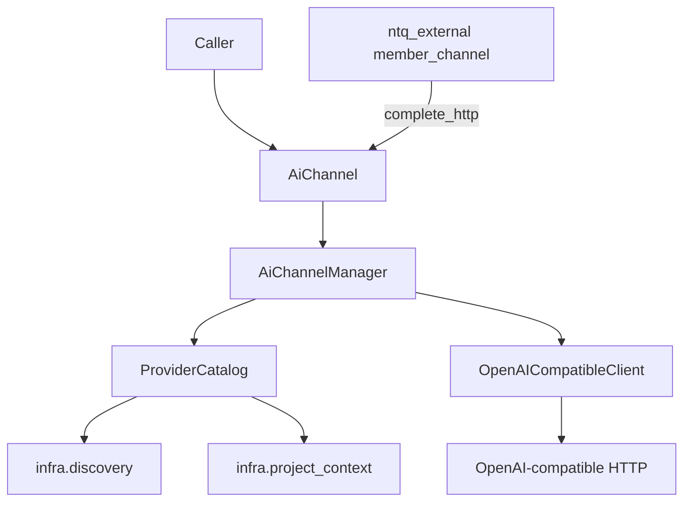

# AI 通道 — 架构

**模块：** `infra.ai` · **版本：** `0.2.0`

**最低支持核心版本：** `>=0.6.0`

本模块是本机 AI 供应商的 HTTP 通道：发现、密钥、裸补全。**不管官网会员、多轮对话、工具调度**（会员见 `modules.ntq_external`；对话编排见 `modules.agent`）。

---

## 职责与边界（结论）

**负责**

- 发现 `userspace/extensions/llm_providers/` 下已安装的本机供应商
- 写入 / 读取供应商 API Key（本地 userspace）
- 对本机供应商或任意 OpenAI 兼容端点发裸补全（`complete` / `complete_http`）

**不负责**

- 官网会员通道、凭证装载、猫粮计费（`modules.ntq_external`）
- 多轮对话 / 上下文管理 / 工具调度 / 系统提示词（`modules.agent`）
- 模型路由策略

---

## 模块结构图

```text
infra/ai/
├── ai_channel.py                 # Facade：AiChannel
├── contracts.py                  # AiError / CompleteResult / ProviderInfo
├── core/
│   ├── ai_channel_manager.py     # 编排：目录解析 + 消息校验 + 调客户端
│   ├── provider_catalog.py       # 实施：扫描 llm_providers、读写 api_key.txt
│   └── openai_compatible_client.py  # 实施：chat/completions HTTP
├── __init__.py                   # 仅导出 AiChannel
├── API.md
├── glossary.yaml
├── module_info.yaml
├── __test__/
└── docs/
    ├── ARCHITECTURE.md
    ├── DECISIONS.md
    └── USER_GUIDE.md
```

---

## 架构图



本机路径：`list_providers` / `set_api_key` / `complete(provider_id=…)`。  
官网路径：业务层解析会员凭证后调 `complete_http`；本模块不 import `ntq_external`。

---

## 数据流（若有）

**本机补全**

```text
Caller → AiChannel.complete(messages, provider_id=…)
  → ProviderCatalog 取 base_url / model / api_key
  → OpenAICompatibleClient.complete_with_meta
  → CompleteResult
```

**业务注入端点（如会员）**

```text
ntq_external.member_channel.complete
  → AiChannel.complete_http(base_url, api_key, model, …)
  → OpenAICompatibleClient
  → CompleteResult(provider_id=ntq)
```

---

## 依赖（结论）

| 依赖 | 用途 |
|------|------|
| `infra.discovery` | 扫描 `llm_providers/*/config.py`、读配置与密钥文件 |
| `infra.project_context` | `get_llm_providers_directory()` 等路径 |

不依赖 `modules.*`。

---

## 相关文档

- [设计与决策](./DECISIONS.md)
- [用户指南](./USER_GUIDE.md)
- [README.md](../README.md)
- [公开 API](../API.md)
- [术语表](../glossary.yaml)
