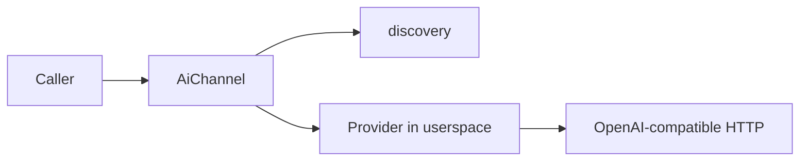

# AI 通道 — 架构

**模块：** `infra.ai` · **版本：** `0.1.0`

## 职责与边界（结论）

管理 AI 供应商发现、API Key 存取与裸补全调用。**只管 HTTP 通道，不管业务**——不做多轮对话、工具调度、系统提示词编排（那是 Agent 的事）。

**职责：**

- 发现 `userspace/extensions/ai/providers/` 下用户装了哪些 AI 供应商
- 写入 / 读取供应商 API Key（本地 userspace）
- 发裸补全请求（OpenAI 兼容协议）

**不做：**

- 多轮对话 / 上下文管理
- 工具调度 / function calling
- 模型选择或路由策略
- 系统提示词模板

## 模块结构图

```text
infra/ai/
├── ai_channel.py           # Facade：AiChannel
├── contracts.py             # Provider 配置类型
├── core/
│   └── providers/           # Provider 基类；实际实现在 userspace
├── __init__.py              # 仅导出 AiChannel
└── __test__/                # 含 test_api.py
```

## 架构图



userspace 供应商由 `list_providers` 发现；Key 经 `set_api_key` 落盘；补全走 `complete`。

## 数据流（若有）

补全请求流程：

```text
调用方 → AiChannel.complete(provider, messages, ...)
  → Provider.complete()
  → HTTP POST（OpenAI 兼容协议）
  → 返回文本 / 抛 ProviderError
```

## 依赖（结论）

| 依赖 | 用途 |
|------|------|
| `infra.discovery` | 扫描 userspace 下的 AI 供应商目录 |
| `infra.project_context` | 定位供应商扩展目录和 API Key 存储路径 |

## 相关文档

- [用户指南](./USER_GUIDE.md)
- [README.md](../README.md)
- [公开 API](../API.md)
- [术语表](../glossary.yaml)
