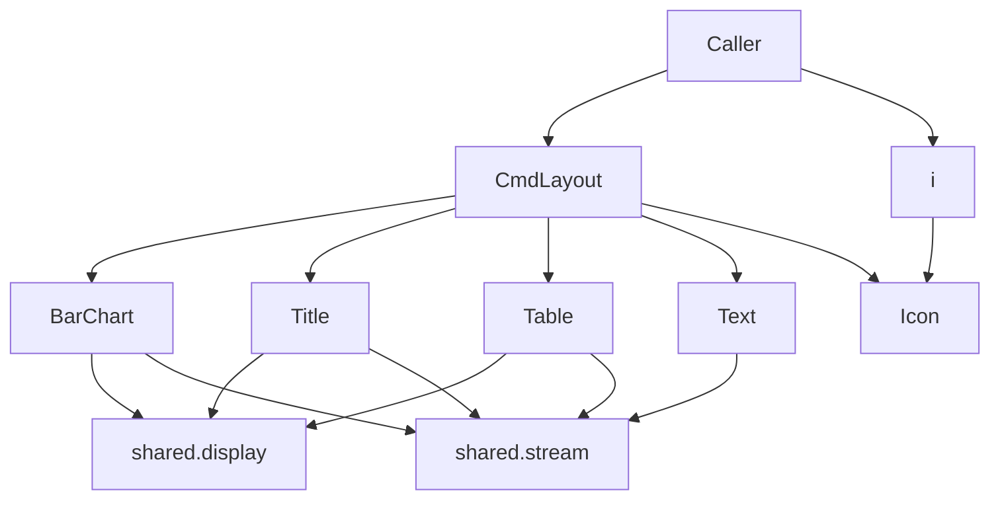

# 命令行布局 — 架构

**模块：** `infra.cmd_layout` · **版本：** `0.3.0`

**最低支持核心版本：** `>=0.5.0`

为终端报告提供纯文本排版片段：标题层级、表格、行内文本、图标、水平条形图。对外入口为门面 `CmdLayout`；包根另保留短入口 `i`（图标）。词条见 [glossary.yaml](../glossary.yaml)。

---

## 职责与边界（结论）

**负责**

- 门面 `CmdLayout` 命名空间：`bar_chart` / `title` / `table` / `text` / `icon`
- 生成可打印字符串（及可选直接打印到流）
- 跨平台默认：条形用 ASCII；图标按终端能力在 emoji 与 ASCII 间切换
- 终端显示宽度（CJK 全角计 2）供标题 / 表 / 条形标签对齐

**不负责**

- 策略报告业务内容与指标计算（调用方组装）
- GUI / Web 图表；进度条产品（见 `infra.progress`）
- 把内部实现类（`Title`、`BarChart`、`IconService` 等）作为跨模块公开 import 面
- 官网业务排版

**有意例外**

- 包根导出 `i`（等价 `CmdLayout.icon.get`），便于 CLI f-string；不另导出其它便捷函数

---

## 模块结构图

```text
core/infra/cmd_layout/
├── cmd_layout.py          # 门面 CmdLayout
├── __init__.py            # 导出 CmdLayout / i
├── shared/
│   ├── stream.py          # StreamWriter
│   └── display.py         # display_width（CJK）
├── bar_chart/             # 分布 / 直方图（含 from_values 预留）
├── title/                 # h1–h4
├── table/
├── text/
├── icon/                  # 正式名图标表（无别名）
├── __test__/
└── docs/
```

实现包目前在模块根下（未收入 `core/`）；行为边界以上表为准。

---

## 架构图



---

## 数据流（若有）

```text
分桶或连续样本 / 标题文本 / 表头行 / 图标正式名
  → CmdLayout.<namespace>.* 或 i(name)
  → str（可选 print 到 stdout / 指定 stream）
```

**直方图预留：** `bar_chart.from_values` 在模块内等宽分桶后走 `render`；生产报告多用已分桶的 `render` / `print`。

---

## 依赖（结论）

- 无模块级 YAML 依赖

---

## 相关文档

- [用户指南](./USER_GUIDE.md)
- [README](../README.md)
- [API.md](../API.md)
- [术语表](../glossary.yaml)
- [快速开始](../QUICKSTART.md)
- [决策](./DECISIONS.md)
