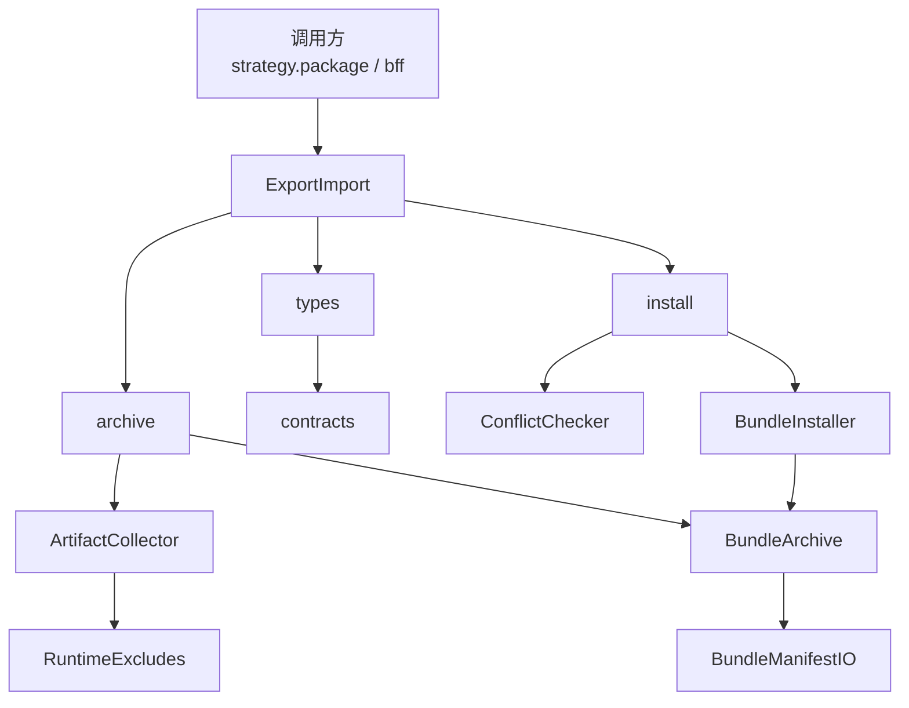

# Export / Import — 架构

**模块：** `infra.export_import` · **版本：** `0.2.1`

**最低支持核心版本：** `>=0.5.0`

门面 `ExportImport` + 实现包 `core/`。词条见 [glossary.yaml](../glossary.yaml)。

---

## 职责与边界（结论）

**负责**

- 按 `ArtifactSpec` 收集可导出文件（跳过运行时目录）
- 生成 manifest + zip；解压；安装前冲突预检与按策略落盘

**不负责**

- 业务依赖解析（strategy 编排层）
- 导入后的 discovery / validate

---

## 模块结构图

```text
core/infra/export_import/
├── export_import.py      # 门面 + TypesNamespace
├── contracts.py          # 类型
├── core/                 # BundleArchive / Collector / Installer / …
│   ├── namespaces.py
│   ├── runtime_excludes.py
│   ├── collect.py / archive.py / manifest.py
│   ├── conflict.py / install.py
│   └── __test__/         # 行为单测
├── __test__/             # 公开 API + TEST_CASES.md
└── docs/
```

---

## 架构图



---

## 数据流

**导出**

```text
ArtifactSpec[]
  → ArtifactCollector（RuntimeExcludes 过滤）
  → zip + manifest.json
  → bytes | Path
```

**安装**

```text
archive
  → extract → manifest
  → ConflictChecker.preflight（policy）
  → BundleInstaller 落盘到 userspace_root
  → InstallResult
```

---

## 相关文档

- [用户指南](./USER_GUIDE.md)
- [API.md](../API.md)
- [术语表](../glossary.yaml)
- [决策](./DECISIONS.md)