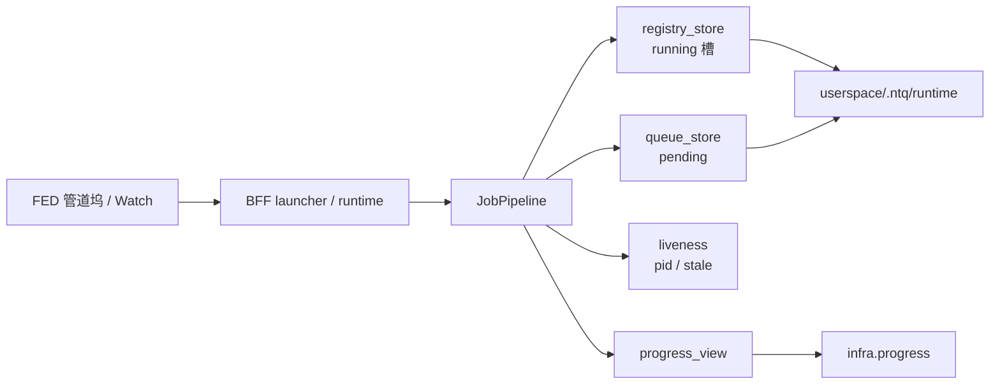
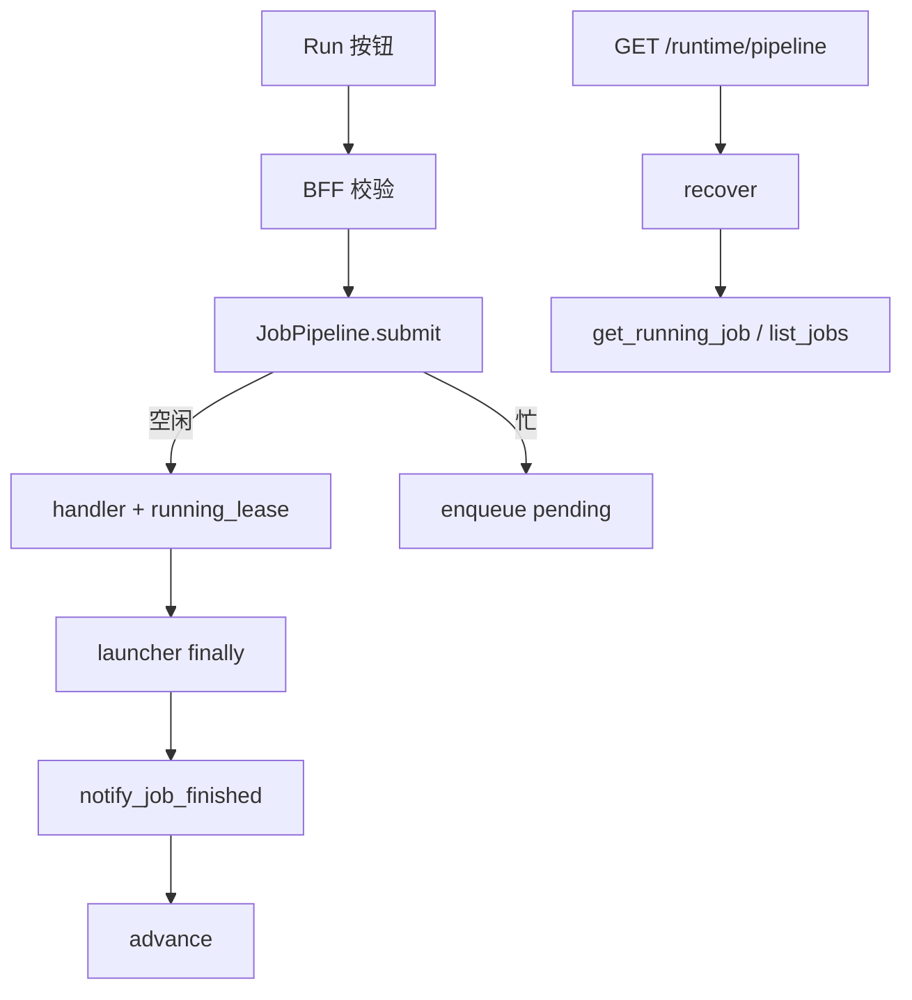

# Job Pipeline — 架构

**模块：** `infra.job_pipeline` · **版本：** `0.1.1`

**最低支持核心版本：** `>=0.6.0`

长任务登记表、串行队列与互斥的基础设施；BFF launcher / 管道坞经 `JobPipeline` 门面读写，细进度仍由 `infra.progress` 提供。

---

## 职责与边界（结论）

**负责**

- 任务表（running 槽 + pending 队列）的落盘与只读视图
- 提交入队 / 串行泵队列（`submit` / `advance`）
- 全局 running 互斥（`filelock` + `running_lease`）
- 死 pid 恢复、进度心跳 stale 标注、强制放弃
- 按 kind 把 Progress 摘要挂到任务快照（不取代细进度读写）

**不负责**

- 业务算法（simulate / tag / renew 如何算）
- 进度树引擎与 channel 协议（→ `infra.progress`）
- 条件并行、依赖图调度、分布式队列（第一期不做）
- 前端未读完成缓冲（→ FED 本地）

---

## 模块结构图

```text
job_pipeline/
├── job_pipeline.py          # Facade
├── contracts.py
├── API.md
├── glossary.yaml
├── module_info.yaml
├── __test__/
├── core/
│   ├── registry_store.py    # running 槽
│   ├── queue_store.py       # pending 队列
│   ├── running_lease.py
│   ├── progress_view.py
│   ├── liveness.py
│   ├── pipeline_constants.py
│   └── running_reader.py
└── docs/
    ├── ARCHITECTURE.md
    ├── DECISIONS.md
    └── USER_GUIDE.md
```

---

## 架构图



---

## 数据流



---

## 依赖（结论）

- `infra.project_context`：定位 `userspace/.ntq/runtime`
- `infra.progress`：任务快照挂细进度摘要；abandon 时写 fail

---

## 相关文档

- [README](../README.md)
- [API.md](../API.md)
- [设计与决策](./DECISIONS.md)
- [用户指南](./USER_GUIDE.md)
- [术语表](../glossary.yaml)
