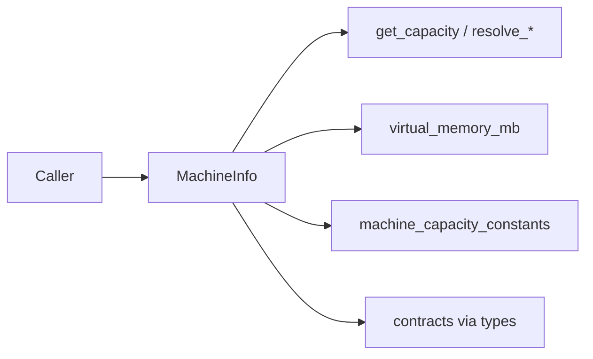

# Machine Capacity — 架构

**模块：** `infra.machine_capacity` · **版本：** `0.2.2`

**最低支持核心版本：** `>=0.5.0`

门面 `MachineInfo` + 契约 `MachineCapacity`。本模块体量小，实现内联在门面文件中。

---

## 职责与边界（结论）

**负责**

- 读本机 CPU / 内存（psutil 可选），结合 `performance` 字段算预算与可用 worker

**不负责**

- `worker.json` / dispatch plan / 进程池执行（属 BacktestEngine）

---

## 模块结构图

```text
core/infra/machine_capacity/
├── machine_capacity.py           # 门面 MachineInfo
├── machine_capacity_constants.py # 预算/保底默认值
├── contracts.py                  # MachineCapacity
├── __test__/                     # 公开 API + 行为单测 + TEST_CASES.md
└── docs/
```

---

## 架构图



---

## 相关文档

- [用户指南](./USER_GUIDE.md)
- [API.md](../API.md)
- [术语表](../glossary.yaml)
- [决策](./DECISIONS.md)
