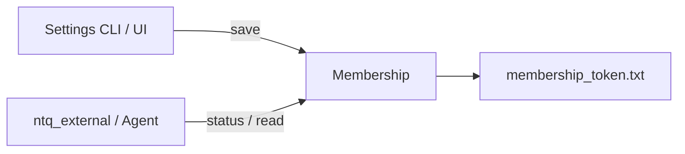
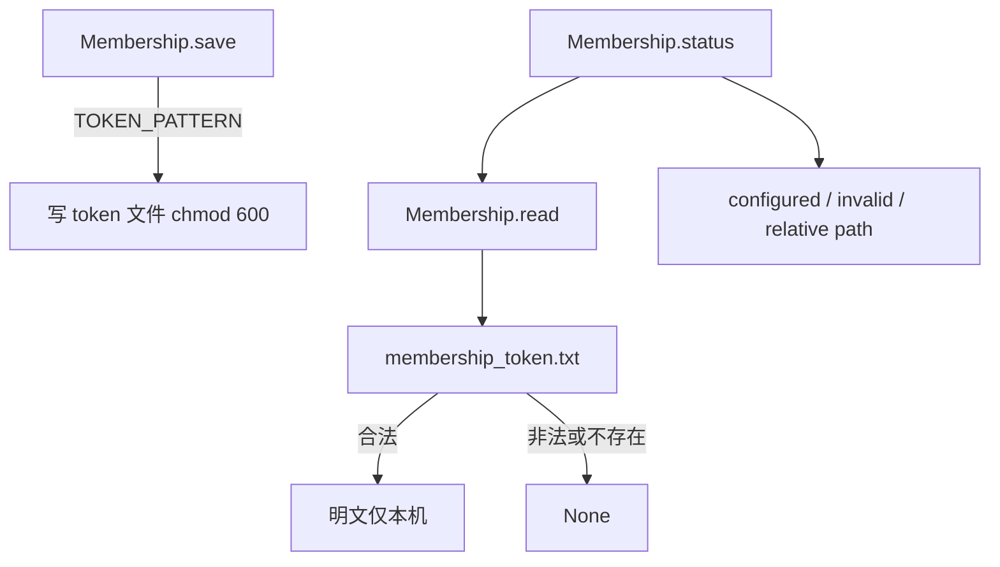

# Membership — 架构

**模块：** `infra.membership` · **版本：** `0.1.1`

**最低支持核心版本：** `>=0.5.3`

## 职责与边界（结论）

官网会员通用凭证的本地存取。**只负责凭证存储与格式校验**，不做在线验证、不回传明文给 HTTP 层。

**职责：**

- 从 `userspace/system/membership/membership_token.txt` 读取凭证
- 写入新凭证（格式校验 + chmod 0600）
- 查询凭证状态（configured / invalid / missing）
- 清除凭证文件

**不做：**

- 在线验证 / 续期（那是 `modules.ntq_external` 走官网的事）
- 回传明文给 HTTP 层
- 会员资料查询（`ntq_external.member_profile` 管）

## 模块结构图

```text
infra/membership/
├── membership.py            # Facade：Membership
├── membership_constants.py  # 路径与格式正则
├── __init__.py              # 导出 Membership
├── API.md / glossary.yaml / README.md
├── docs/                    # ARCHITECTURE · DECISIONS · USER_GUIDE
└── __test__/                # test_api.py · TEST_CASES.md
```

## 架构图



`save` 做格式校验与写盘；`status` / `read` 不向 HTTP 回传明文。

## 数据流



不做缓存；每次按需读写。

## 依赖（结论）

| 依赖 | 用途 |
|------|------|
| `infra.project_context` | `ProjectContext.path.get_membership_token_file` |

## 相关文档

- [用户指南](./USER_GUIDE.md)
- [README.md](../README.md)
- [公开 API](../API.md)
- [术语表](../glossary.yaml)
- [决策](./DECISIONS.md)
