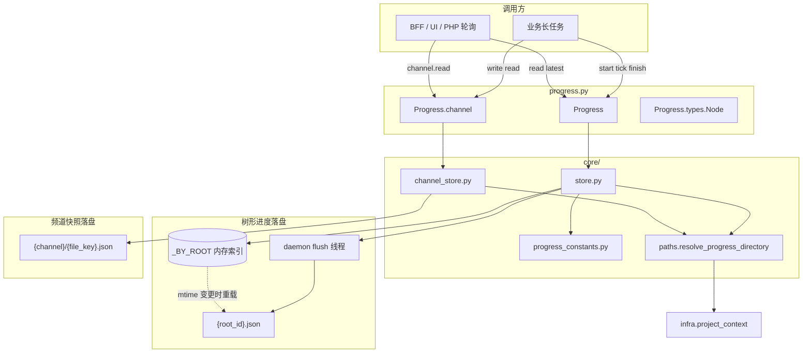

# Progress — 架构

**模块：** `infra.progress` · **版本：** `0.2.3`

**最低支持核心版本：** `>=0.6.0`

本模块把进度写成文件。根节点和每一层 steps 是同一种节点。界面和 PHP 读文件里的 ratio。另提供无业务语义的频道快照（`Progress.channel`），供策略 / 标签等模块约定自己的 channel 名。

---

## 职责与边界（结论）

**负责**

- 按节点 id 更新进度树，并写入 `userspace/.ntq/tmp/progress/{根id}.json`
- 频道化 job 快照：`progress/{channel}/{file_key}.json`（`Progress.channel`）
- 在写入时算好每个节点的 ratio
- tick 时打一行日志
- 读取最新内容；合并短时间内的重复写盘

**不负责**

- 不保存任务结果、机会列表或失败日志
- 不替调用方决定业务步骤的含义
- 不在内部用定时器把进度往前推
- 不定义 strategy / tag 等业务 channel 名（见 [DEC-04](./DECISIONS.md#dec-04)）

**依赖方向**

- 允许：`infra.project_context` → userspace `tmp/progress` 根路径
- 禁止：本模块不 import `core.modules`；业务 channel 名留在各业务模块

---

## 模块结构图

```text
core/infra/progress/
├── progress.py              # Facade Progress + Progress.channel
├── contracts.py             # ProgressNode
├── core/
│   ├── store.py             # 树形进度：内存索引 + 延迟写盘
│   ├── channel_store.py     # 频道快照：即时原子写
│   ├── progress_constants.py
│   └── paths.py
├── __test__/
└── docs/
```

---

## 架构图



---

## 数据流

**树形进度**

```text
start → 建索引 → _publish（内存 + 可选延迟写盘）
tick / finish / fail / … → _mutate → _recompute ratio → _publish
read / latest → 内存深拷贝（_refresh_index 对齐磁盘 mtime）
```

**频道快照**

```text
channel.write → 即时 replace 单文件（自动补 updated_at ISO）
channel.read / clear → 不经过内存索引
```

同一次根上的连续 tick 先改内存，再经 `NTQ_PROGRESS_FLUSH_DELAY` 合并写盘；`read` 立刻看到内存最新树。测试与 CI 可设 `NTQ_PROGRESS_DIR`（树与 channel 共用根）。

---

## 依赖（结论）

- `infra.project_context`：定位 userspace 临时目录下的 `progress` 段

---

## 相关文档

- [用户指南](./USER_GUIDE.md)
- [README](../README.md)
- [API.md](../API.md)
- [术语表](../glossary.yaml)
- [快速开始](../QUICKSTART.md)
- [决策](./DECISIONS.md)