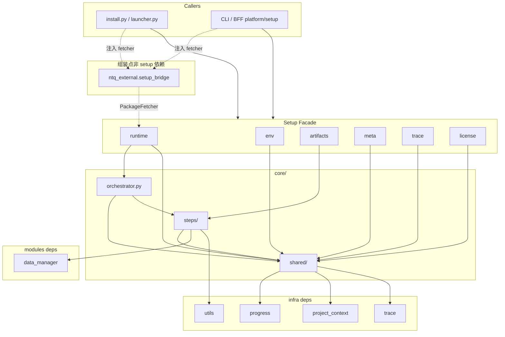

# Setup 架构文档

**模块：** `infra.setup` · **版本：** `0.2.1`

**最低支持核心版本：** `>=0.5.0`

## 职责与边界（结论）

`infra.setup` 是安装域：判断是否需要安装、跑步骤流水线、生产 userspace 模板 zip、演示包导入/导出、UI/CLI 安装编排。
**核心设计：** setup 全权管理安装；CLI 只调用 `Setup` 门面。冷启动（`install.py` / `launcher.py` / Docker zip）不依赖 argparse CLI。

**In scope：** venv、依赖、userspace 初始化、演示数据导入/导出（目录 `userspace/.ntq/packages/{demo|member|full}/`；导入前可从官网拉 zip）、安装状态、产物 zip 的**生产逻辑**  
**Out of scope：** 应用升级（见 `infra.updater`）；官网静态包托管（见站点 `ntq_data`）；用户策略/打标命令

## 架构图

```text
core/infra/setup/
  setup.py / contracts.py
  core/
    orchestrator.py       # 唯一编排：协调 steps + 全局状态（CLI/UI 入口）
    shared/               # env / install_runtime / meta / progress / trace / license / session …
    steps/                # 各安装步骤 + 步骤内产物工厂
      init_userspace/assets/   # userspace.zip 模板
      import_data/export/      # 演示包导出（原 scripts/init_data）

userspace/.ntq/packages/{demo|member|full}/  # 演示包（导出/下载）
.ntq/setup-runtime.json                      # CLI 与 UI 向导共用的完成态（isReady）
.ntq/install-state.json                      # 依赖指纹 / cliRuntime / uiRuntime
```

```text
Setup
  ├── env        → shared.env.NewTeaQuantSetup
  ├── runtime    → orchestrator + shared.install_runtime / setup_session / install_progress
  ├── artifacts  → steps.init_userspace.package / steps.import_data.export
  ├── meta       → shared.meta_loader
  ├── trace      → shared.trace_events.SetupTrace
  ├── license    → shared.license_acceptance
  └── types      → contracts
```



## 相关文档

- [用户指南](./USER_GUIDE.md)
- [API.md](../API.md)
- [安装失败 Trace 排障（TODO）](./notes/INSTALL_TRACE_TODO.md)
- [术语表](../glossary.yaml)
- [决策](./DECISIONS.md)