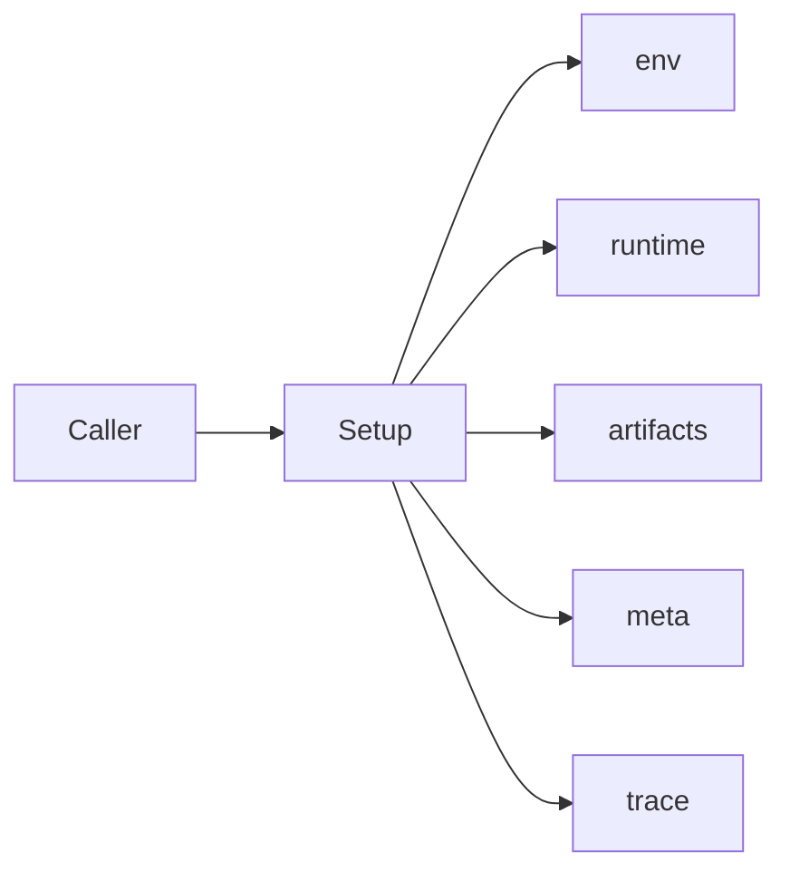

# Setup 架构文档
**版本：** `0.1.2`

## 职责与边界（结论）

`infra.setup` 是安装域：判断是否需要安装、跑步骤流水线、生产 `initialization/userspace` 产物、演示包导入/导出、UI/CLI 安装编排。
**核心设计：** setup 全权管理安装；CLI 只调用 `Setup` 门面。冷启动（`install.py` / `launcher.py` / Docker zip）不依赖 argparse CLI。

**In scope：** venv、依赖、userspace 初始化、演示数据导入/导出（目录 `userspace/.ntq/packages/install_demo/`；导入前可从官网拉 zip）、安装状态、产物 zip 的**生产逻辑**  
**Out of scope：** 应用升级（见 `infra.updater`）；官网静态包托管（见站点 `ntq_data`）；用户策略/打标命令

## 架构图

```text
core/infra/setup/         # 执行层
  setup.py / contracts.py
  core/{env, install_runtime, cli_runtime, ui_runtime, setup_session, steps, scripts}

initialization/userspace/   # 仓库根 userspace 模板
userspace/.ntq/packages/install_demo/  # 演示包（导出/下载）
.ntq/setup-runtime.json                          # CLI 与 UI 向导共用的完成态（isReady）
```

```text
Setup
  ├── env        → core.env.NewTeaQuantSetup + 路径常量
  ├── runtime    → core.install_runtime / cli_runtime / ui_runtime / setup_session
  ├── artifacts  → core.scripts.init_userspace / init_data
  ├── meta       → core.meta_loader
  ├── trace      → core.trace_events.SetupTrace
  └── types      → contracts
```



## 相关文档

- [用户指南](./USER_GUIDE.md)
- [API.md](../API.md)
- [安装失败 Trace 排障（TODO）](./notes/INSTALL_TRACE_TODO.md)
- [术语表](../glossary.yaml)
- [决策](./DECISIONS.md)
