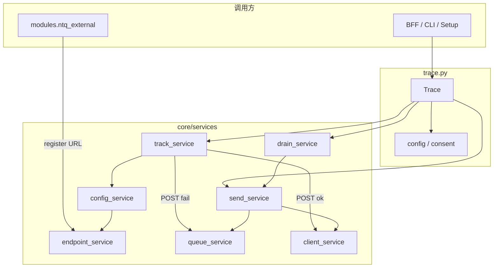

# Architecture — infra.trace

**模块：** `infra.trace` · **版本：** `0.1.4`

**最低支持核心版本：** `>=0.5.0`

使用统计上报（opt-in）。同意、配置解析、事件构建、POST / 本地队列、后台 drain 均在本模块；官网 ingest URL 由 `modules.ntq_external` 调用 `TraceEndpointService.register` 登记，trace **不** import modules。

---

## 职责与边界（结论）

**负责**

- 用户同意读写（`trace_consent.json` + 环境变量覆盖）
- 事件脱敏、附带匿名机器规格、installation_id
- 立即 POST（`track`）与本地队列（`queue` / `send` / BFF drain）
- 安装类事件（`track_setup`）在发送端声明可跳过使用统计同意时上报

**不负责**

- 官网地址常量（`ntq_external` 登记；未登记则无默认 URL）
- 应用内软反馈（`ntq_external.feedback`）
- UI 请求排障用 `traceId`

**依赖方向**

- 允许：`infra.project_context`、`infra.machine_capacity`
- 禁止：本模块不 import `core.modules`（登记由模块侧调用 `TraceEndpointService.register`）

---

## 模块结构图

```text
core/infra/trace/
├── trace.py                 # Facade Trace（static）
├── contracts.py             # TraceEvent / TraceConfig / TraceConsent / SendBudget
├── core/
│   ├── defaults.py          # TraceDefaults（tunables；无 ingest URL）
│   ├── namespaces.py        # config / consent 命名空间
│   └── services/            # *Service 静态实现
├── __test__/                # test_api + TEST_CASES
└── docs/
```

---

## 架构图



---

## 数据流

**同意优先级（关 → 不发普通事件）**

```text
NTQ_TRACE_SKIP=1 / GITHUB_ACTIONS=true > NTQ_TRACE_ENABLED > trace_consent.json > false
```

**配置优先级（target_url / timeout 等）**

```text
NTQ_TRACE_ENDPOINT / NTQ_TRACE_TIMEOUT > userspace/system/config/trace.json > 已登记 URL / TraceDefaults
```

**运行时**

0. 未同意 → `track` / `queue` / `send` 直接返回（`track.decision` 等例外见代码）
1. `consent.set` 落盘 → 可选 `track.decision`
2. `track`：sanitize → POST；失败 → 本地 queue
3. `queue`：sanitize → 仅入队
4. `send` / drain：按预算 POST queue → 成功删 / 失败回队

---

## 相关文档

- [用户指南](./USER_GUIDE.md)
- [公开 API](../API.md)
- [术语表](../glossary.yaml)
- [决策](./DECISIONS.md)