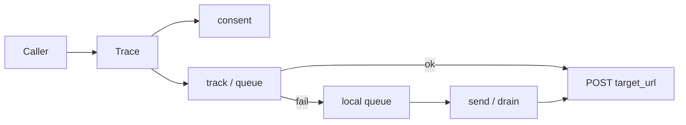

# Architecture — infra.trace

**模块：** `infra.trace` · **版本：** `0.1.2`

**最低支持核心版本：** `>=0.5.0`

## 模块结构图

```text
Trace (Facade, static API)
  ├── ask_permission / track / queue / send / start_background_drain
  ├── config / consent / types
        │
        ▼
  contracts.py      TraceEvent / TraceConfig / TraceConsent / SendBudget
  core/defaults.py  TraceDefaults（内置 URL / 超时等唯一源）
  core/services/    Config · Consent · … · Client · Send · Drain
```

## 架构图



```text
NTQ_TRACE_SKIP=1  /  GITHUB_ACTIONS=true  >  NTQ_TRACE_ENABLED=0/1  >  userspace/system/prefs/trace_consent.json  >  false
```

```text
NTQ_TRACE_ENDPOINT / NTQ_TRACE_TIMEOUT
  >  userspace/system/config/trace.json
  >  TraceDefaults（core/defaults.py）
```

不进 `core/default_config/`：tracing 为 opt-in，默认值与同意分离。

```python
from core.infra.trace import Trace

Trace.track("install.complete", {"success": True})
Trace.queue("app.session_start", {})
Trace.send(budget="standard")
# 内置默认 URL：
# core.modules.ntq_external.conf.endpoints.TRACE_URL
```

## 数据流（若有）

0. 未取得同意 → 普通 `track` / `queue` / `send` 直接返回（`track.decision` 除外）
1. 用户做出同意决定 → `consent.set` 落盘后发出 `track.decision`（`enabled` + `source`）
2. `track`：sanitize → POST；失败 → 本地 queue
3. `queue`：sanitize → 本地 queue
4. `send`：claim → POST `target_url` → 成功删 / 失败回队
5. CLI 退出可 `send`；BFF 后台 drain 调 `send`

## 职责与边界（结论）

- 不采集主机名、真实用户 ID、策略/行情内容
- 每条事件 `meta` 含：`os` / `cpu_cores` / `memory_mb` / `db` / `disk_type` / `python_version` / `arch` / `ntq_version`
- 失败静默；不阻塞业务
- 与 UI `traceId`（请求排障）无关

## 相关文档

- [用户指南](./USER_GUIDE.md)
- [公开 API](../API.md)
- [术语表](../glossary.yaml)
- [决策](./DECISIONS.md)
