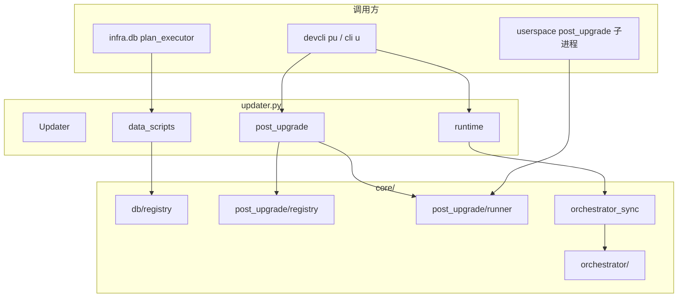

# Updater 架构文档

**模块：** `infra.updater` · **版本：** `0.1.1`

**最低支持核心版本：** `>=0.5.0`

应用升级编排源码、DB 数据脚本注册表、post-upgrade 收尾；运行时从 `userspace/system/updater` 执行。

---

## 职责与边界（结论）

**负责**

- `Updater.data_scripts`：按 action_id 注册 / 运行 DB 迁移单步脚本
- `Updater.post_upgrade`：升级后收尾动作注册与 `run`
- `Updater.runtime.sync_orchestrator`：将编排源码同步到 userspace（CLI `pu` / Setup 打包）

**不负责**

- 首次安装、安装 wizard、`needs_install`（`infra.setup`）
- 从当前 core 进程直接跑完整升级流水线（镜像内 userspace updater 子进程执行）
- migrate CLI 深度产品化（见 [DEC-02](./DECISIONS.md#dec-02预生产形态与后续重做范围)）

**依赖方向**

- 允许：`infra.utils`（重装依赖等）
- 禁止：本模块不 import `core.modules`

---

## 模块结构图

```text
core/infra/updater/
├── updater.py              # Facade Updater
├── contracts.py              # 注册表类型 / PostUpgradeRunResult
├── core/
│   ├── db/registry.py        # DataScriptRegistry
│   ├── post_upgrade/         # registry + runner + 内置 actions
│   ├── orchestrator/         # 升级流水线源码（userspace 镜像内跑）
│   └── orchestrator_sync.py
├── __test__/
└── docs/
```

---

## 架构图



**主路径（文本）**

```text
devcli pu / Setup ──► Updater.runtime.sync_orchestrator ──► userspace/system/updater
userspace updater ──subprocess──► python -m core.infra.updater.core.post_upgrade run
infra.db plan_executor ──► Updater.data_scripts.run
```

---

## 相关文档

- [用户指南](./USER_GUIDE.md)
- [API.md](../API.md)
- [术语表](../glossary.yaml)
- [决策](./DECISIONS.md)