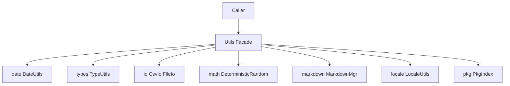

# Utils 架构文档

**模块：** `infra.utils` · **版本：** `0.2.3`

**最低支持核心版本：** `>=0.5.0`

与业务无关的通用工具，经 Facade `Utils` 暴露；无 `core.modules` 依赖。

---

## 职责与边界（结论）

**负责**

- 日期解析 / 区间 / 季度辅助（`Utils.date`）
- 类型与 DataFrame 判断（`Utils.types`）
- CSV 与归档读写（`Utils.io`）
- 确定性 `[0,1)` 浮点（`Utils.math`）
- Markdown 模版填充（`Utils.markdown`）
- 本机是否中国大陆（`Utils.locale` / `Utils.is_china`）
- pip / npm 依赖源探测与镜像（`Utils.pkg`）

**不负责**

- 配置合并与用户目录解析（`infra.project_context`）
- 业务默认起止日（`ProjectContext.config`）
- CLI 图标与布局（`infra.cmd_layout`）
- 交易日历业务规则（各业务模块）

---

## 模块结构图

```text
core/infra/utils/
├── utils.py                  # Facade Utils + Io / Math 命名空间
├── contracts.py              # PERIOD_* / PeriodType / ArchiveFormat
├── core/
│   ├── date/                 # DateUtils + parser / calculator / period
│   ├── type_utils.py
│   ├── io/                   # CsvIo / FileIo
│   ├── math/deterministic_random.py
│   ├── markdown/
│   ├── locale/
│   └── pkg_index/
├── __test__/
└── docs/
```

---

## 架构图



---

## 相关文档

- [用户指南](./USER_GUIDE.md)
- [API.md](../API.md)
- [术语表](../glossary.yaml)
- [决策](./DECISIONS.md)