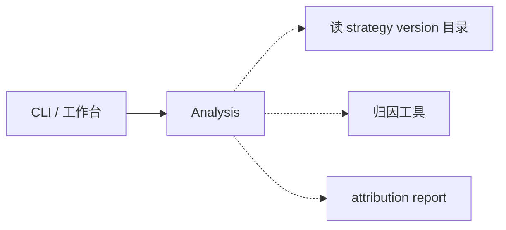

# Analysis — 架构

**模块：** `modules.analysis` · **版本：** `0.1.0`

**最低支持核心版本：** `>=0.5.0`

本模块是回测**之后**的解释层：消费 strategy 已落盘产物，解释 inputs 与 outputs 的关系。当前仅有 Facade 占位，无内部组件。

---

## 职责与边界（结论）

**负责**

- 作为独立模块存在，避免把归因做进 `modules.strategy`
- 提供日后归因行为的唯一对外入口 `Analysis`

**不负责**

- 不调度、不推进 Timeline（`modules.backtest_engine`）
- 不产生 enumerate / price_factor / portfolio 产物（`modules.strategy`）
- 不做全市场因子库、滚动验证、因子挖掘（未来 factor 模块）
- 本版本不读盘、不算数、不写报告

---

## 模块结构图

```text
analysis/
├── analysis.py          # Facade Analysis（空类）
├── contracts.py         # 公开类型（当前无符号）
├── API.md / glossary.yaml / module_info.yaml
├── __test__/            # 公开契约
├── core/                # 内部实现（空）
└── docs/
    ├── ARCHITECTURE.md
    ├── DECISIONS.md     # 已定 + 待决设计点
    └── CONCEPTS.md      # 三个未决问题的思考框架
```

---

## 架构图

当前仅 Facade 骨架；下游未实现。



strategy 三步模拟与 BE 调度不经过本模块。

---

## 数据流（若有）

未定。候选方向见 [DECISIONS.md](./DECISIONS.md)：只读 `results/simulations/`，不另建结果库。

---

## 依赖（结论）

- 无。日后若读模拟产物，再声明 `modules.strategy`（只经其公开读路径）。

---

## 相关文档

- [用户指南](./USER_GUIDE.md)
- [README](../README.md)
- [API.md](../API.md)
- [术语表](../glossary.yaml)
- [概念](./CONCEPTS.md)
- [决策](./DECISIONS.md)
