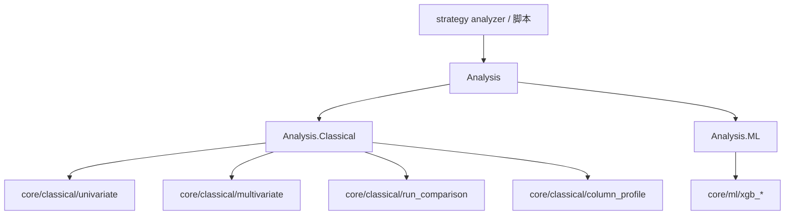

# Analysis — 架构

**模块：** `modules.analysis` · **版本：** `0.1.1`

**最低支持核心版本：** `>=0.5.0`

本模块提供**无 I/O** 的统计/ML 原语：调用方（主要是 `modules.strategy` analyzer）组装对齐列向量后传入，本模块只做数学并返回结构化 `dict`。不读 `simulations/`、不写报告文案。

---

## 职责与边界（结论）

**负责**

- 分桶、Spearman、逻辑回归 / OLS、两次 run 摘要对照、可选 XGBoost+SHAP
- 经 `Analysis.Classical` / `Analysis.ML` 暴露唯一对外入口形状

**不负责**

- 读策略产物、调度回测（`modules.backtest_engine`）
- 三层 simulate / 报告编排（`modules.strategy`）
- 全市场因子库、滚动 IC（未来 factor 模块）

---

## 架构图

实现细节留在 `core/`；跨模块禁止 deep-import 上述子模块。

---

## 数据流

无内置读盘。典型路径：analyzer 从已解析的行向量调用 `quantile_buckets` / `spearman_correlation` 等 → 得到 `status` + 载荷 → analyzer 写入 report 节。

---

## 依赖（结论）

- 运行时：`numpy`、`pandas`（classical）；ML 子集另需 `xgboost`（及可选 `shap`），缺则 `skipped`
- NTQ 模块依赖：无

---

## 相关文档

- [用户指南](./USER_GUIDE.md)
- [README](../README.md)
- [API.md](../API.md)
- [术语表](../glossary.yaml)
- [概念](./CONCEPTS.md)
- [决策](./DECISIONS.md)