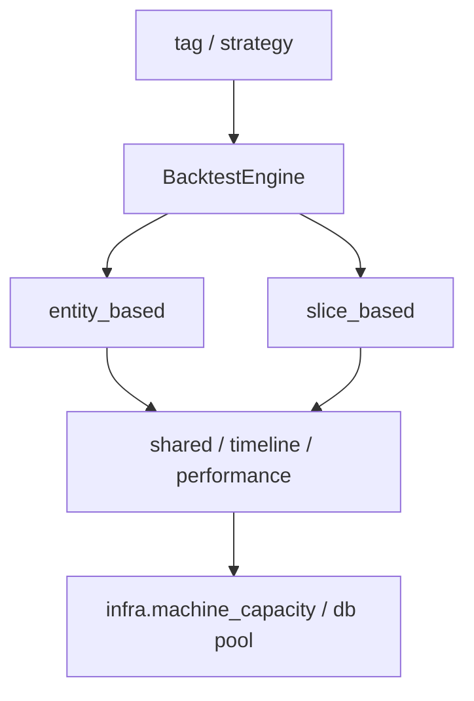

# Backtest Engine — 架构

**模块：** `modules.backtest_engine` · **版本：** 0.2.0

回测调度 Facade：对 tag / strategy 提供统一的 **probe → plan → execute → monitor** 流水线。业务语义经 `RunCallbacks`（`on_task_start` / `on_tick` / `on_task_complete` 等）注入；engine 只管并发、内存预算与执行编排。钩子只表示时间点，不暗示业务动作。

---

## 职责与边界（结论）

| In scope | Out of scope |
|----------|--------------|
| 两种执行模式（entity_based / slice_based） | 业务计算与入库 |
| Job 契约校验、dispatch 规划、探针 | 读取 global `worker.json` dispatch |
| ProcessPool（entity）/ 主进程 orchestrator（slice） | 数据源任务调度 |
| `RunCallbacks`、内置进度、`RunResult` | 用户 settings 中的 performance 覆盖 |

**公开 API 边界：**

| 公开 | 内部（勿跨模块 import） |
|------|-------------------------|
| `BacktestEngine` | `EntityPlanner`, `SliceExecutor`, … |
| `contracts.*` | `core/schedule/*`, `core/performance/*`（除经 contracts 导出者） |

契约细节见根目录 `API.md` 与 `glossary.yaml`。

---

## 架构图

应用层经 Facade 分到两种 schedule；细节见下方目录树。



## 模块结构图

**目录树：**

```text
backtest_engine/
├── README.md / API.md / QUICKSTART.md
├── backtest_engine.py       # Facade
├── contracts.py             # 跨模块契约 re-export
├── glossary.yaml
├── module_info.yaml
├── core/
│   ├── shared/              # jobs, types, modes, progress, …
│   ├── performance/         # settings, profiler, worker_profile/
│   ├── timeline/            # Timeline 发布 / drive / worker
│   └── schedule/
│       ├── entity_based/    # pipeline / planner / probe / executor / monitor
│       └── slice_based/     # + orchestrator / reader_pool / slice_width
├── docs/
│   ├── ARCHITECTURE.md
│   ├── DECISIONS.md
│   └── SLICE_BASED_ALGORITHM.md  # slice_based 算法 SOT（硬约束）
├── __test__/                # 含 test_api.py；用例索引见 TEST_CASES.md
└── __performance__/         # 调度空转性能基线（非公开 API）
```

---

## 数据流（若有）

probe → plan → execute → monitor；两种模式下具体执行器不同。用户 settings **不含** `performance`。

```text
EntityBasedPerformance.base()
    + profile_*_config()   # tag/strategy dispatch.yaml
    → resolve_entity_based_performance()
    → planner / executor

SliceBasedPerformance.base()
    + profile_*_calendar_slice_config()
    → resolve_slice_based_performance()
    → SliceBasedPerformance.resolve_for_planning()
```

两种模式共用：**validate → plan → monitor setup → execute → RunResult**。有 jobs 时须先就绪 Timeline（`run(start=, end=)` 或 `set_timeline`）。内置进度：prep 5% → plan 10% → execute 80% → finish 5%；始终计算，`enable_progress_display` 仅控制 CMD 日志。

### entity_based

1. **Plan**：机器容量 → 可选 dispatch probe → `DispatchPlan`
2. **Execute**：`ProcessPoolExecutor`；worker 经 `TimelineWorkerExecute` + `callbacks.on_tick` 推进
3. **Monitor**：按 job 采样 RSS/耗时，动态调整 in-flight

### slice_based

**算法 SOT：** [SLICE_BASED_ALGORITHM.md](./SLICE_BASED_ALGORITHM.md)。

1. **Probe** → **Plan**（片宽 / `preload_depth`）  
2. **Execute**：按正式片装载；`SliceWorkerExecute` + orchestrator；**禁止**全窗一次加载  
3. **Monitor**：按片样本；压力时下调预读深度  

IO 不变量：正式片数 N ⇒ 至少 N 次按片 DB 装载。

---

## 依赖（结论）

- `core.infra.machine_capacity` — CPU/内存预算
- `Db.duckdb.worker_pool`（`core.infra.db`）— 可选 DuckDB 进程池包装
- Python `concurrent.futures.ProcessPoolExecutor`（entity_based 外层池）

---

## 相关文档

- [用户指南](./USER_GUIDE.md)
- [README.md](../README.md)
- [公开 API](../API.md)
- [SliceBased 算法 SOT](./SLICE_BASED_ALGORITHM.md)
- [术语表](../glossary.yaml)
- [决策](./DECISIONS.md)
