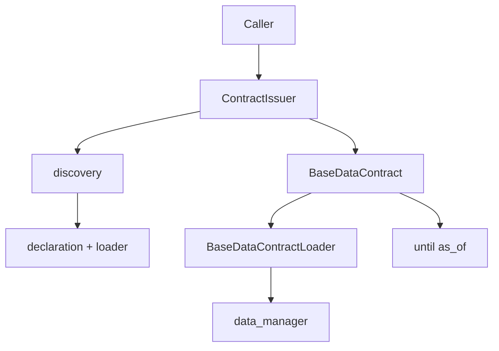

# Data Contract 架构文档

**模块：** `modules.data_contract` · **版本：** `0.4.4`

**最低支持核心版本：** `>=0.5.0`

## 模块结构图

将「策略/标签声明的数据依赖」收敛为 **`DATA_KEY` → declaration + loader`**，经 **发现 → 签发 → 填充 →（时序）PIT 游标** 交付。公开 Facade 为 **`ContractIssuer`**。

```text
modules.data_contract/
├── __init__.py              # 仅 ContractIssuer（Facade）
├── data_contract.py         # Facade 实现入口（re-export ContractIssuer）
├── contracts.py             # DATA_KEY / 基类 / 专用子类（无 Issuer）
├── core/
│   ├── discovery/           # ContractIssuer 实现
│   ├── base/                # Base*Contract、Loader、CursorState
│   └── data_contracts/<key>/
│       ├── declaration.py   # 必需
│       ├── loader.py        # 必需（除非 contract 自管取数）
│       └── contract.py      # 可选：meta.contract_class 自定义子类
├── docs/
└── __test__/                # 公开 API 契约测
```

| 层 | 包 | 职责 |
| --- | --- | --- |
| Facade | 包根 / `ContractIssuer` | `issue`、discover、get_contract |
| 类型 | `contracts.py` | `DATA_KEY`、基类、专用子类（如 `StockStPeriodsContract`） |
| 基类 | `core/base/` | meta/runtime/specific；`until` / `fill_in_data` |
| 实现 | `core/data_contracts/<key>/` | declaration + loader；可选 `contract.py` |

---

## 架构图



---

## 数据流（若有）


---

## 职责与边界（结论）

**负责：** DATA_KEY 白名单、签发、loader 取数、时序 `until`、userspace 契约脚手架  
**不负责：** DB schema/SQL（`data_manager`）；策略/标签编排与回测调度

---

## 相关文档

- [用户指南](./USER_GUIDE.md)
- [CONCEPTS.md](./CONCEPTS.md)
- [API.md](../API.md)
- [glossary.yaml](../glossary.yaml)
- [决策](./DECISIONS.md)
