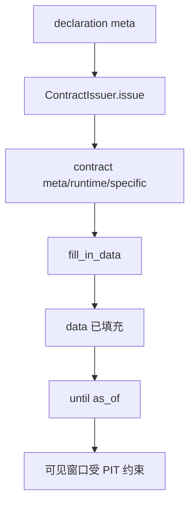

# Data Contract — 概念与运作

**模块：** `modules.data_contract` · **版本：** `0.4.4`

**最低支持核心版本：** `>=0.5.0`

本文写**主链路怎么串**（签发 → 物化 → PIT 推进）以及 scope / type 如何组合选用。单个英文词的含义见 [glossary.yaml](../glossary.yaml)。

文字入口见 [README.md](../README.md)；调用见 [API.md](../API.md)。

---

## 1. 主链路：issue → fill_in_data → until

1. **声明**：每个 data key 有一份 declaration（meta：key / type / scope / loader；PER_ENTITY 另需 `list_data_key`）。
2. **签发**：`ContractIssuer.issue(key, ...)` 得到句柄（`BaseDataContract` 或 `meta.contract_class` 子类）。同一 key 多次 issue → 不同 `contract_id`。
3. **物化**：`fill_in_data`（或 `issue(..., fill_in_data=True)`）调 loader 写入 `data`。GLOBAL 一次 `load`；PER_ENTITY 按 `entity_ids` 单载或 `load_batch`。
4. **PIT（仅 TIME_SERIES）**：`until(as_of=...)` 推进可见上界，避免未来函数。NON_TIME_SERIES 无此步。

---

## 2. 两个正交维度：Scope × Type

选契约时先问两件独立的事：

| 维度 | 问题 | 取值 |
| --- | --- | --- |
| **Scope** | 一份数据归谁用？ | `GLOBAL`（共享） / `PER_ENTITY`（按实体分片，须 `list_data_key`） |
| **Type** | 有没有统一时间轴？ | `TIME_SERIES`（可 `until`） / `NON_TIME_SERIES`（清单/映射） |

四象限都合法，例如：GLOBAL + TIME_SERIES（宏观序列）、PER_ENTITY + NON_TIME_SERIES（每股静态属性）。词义与对比见 glossary 中 `ContractScope`、`ContractType`、`GLOBAL`、`PER_ENTITY`、`TimeSeries`、`NonTimeSeries`。

---

## 3. 代码入口（读代码时落点）

| 内容 | 位置 |
| --- | --- |
| Facade | `from core.modules.data_contract import ContractIssuer` |
| 键与基类 | `from core.modules.data_contract.contracts import DATA_KEY, …` |
| 系统 key 表 | `core/data_contracts/data_keys.py` |
| 各契约实现 | `core/data_contracts/<key>/` |
| Issuer 实现 | `core/discovery/contract_issuer.py`（勿作公开 deep-import） |

---

## 4. Userspace 扩展（步骤）

1. **key**：userspace `USER_DATA_KEY`
2. **declaration.py**：meta（type / scope / loader；PER_ENTITY 含 `list_data_key`）
3. **loader.py**：继承 `BaseDataContractLoader`，实现 `load`（可选 `load_batch`）
4. **contract.py**（可选）：自定义子类 + `meta.contract_class`

热更新：`ContractIssuer.reload()` 可重新发现系统与 userspace 契约。

---

## 5. 应用层边界

Contract 覆盖**用户声明的数据依赖**。未声明的编排数据（宇宙、日历等）默认不强制走本模块；写入 settings extras 后则应走 `ContractIssuer`。

---

## 相关文档

- [README](../README.md)
- [API.md](../API.md)
- [术语表](../glossary.yaml)
- [架构](./ARCHITECTURE.md)
