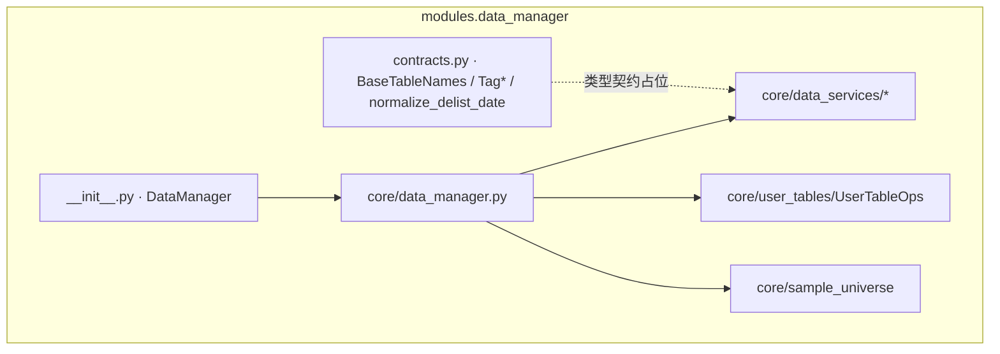
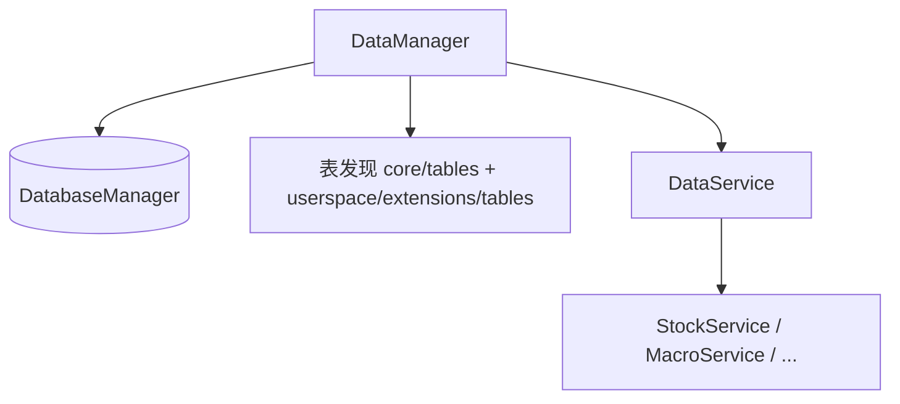

# Data Manager 架构文档

**模块：** `modules.data_manager` · **版本：** `0.2.4`

**最低支持核心版本：** `>=0.5.0`

## 模块结构图

提供 **Facade + 领域服务**：`DataManager` 管理单例、库初始化与表注册；领域逻辑在 **`core/data_services/`**，经属性链访问（`data_mgr.stock.kline.load`）。
公开 Facade：**`DataManager`**；跨模块类型见 **`contracts.py`**。

| 层 | 职责 |
| --- | --- |
| Facade | `DataManager`：`initialize`、表发现/注册、领域属性 |
| 协调 | `DataService`：挂载 stock / macro / calendar / index / db_cache / backup_restore |
| 领域 | 各 `*_service` 封装表读写 |

---

## 数据流（若有）

---

## 职责与边界（结论）

**In scope：** 已落地表读写、领域查询、Model 实例化、开发样本股票宇宙  
**Out of scope：** 抓取（`data_source`）；`DataKey` 签发（`data_contract`）

---

## 相关文档

- [用户指南](./USER_GUIDE.md)
- [API.md](../API.md)
- [glossary.yaml](../glossary.yaml)
- [决策](./DECISIONS.md)
