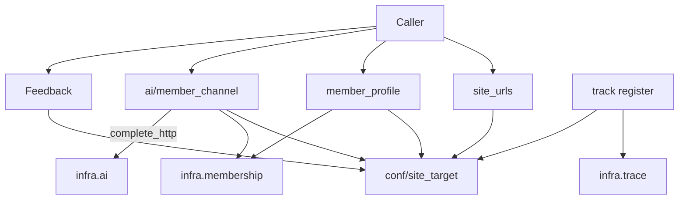

# NtqExternal — 架构

**模块：** `modules.ntq_external` · **版本：** `0.2.1`

**最低支持核心版本：** `>=0.6.0`

## 职责与边界（结论）

把「与官网通信」收在一个模块里：

- 对外地址的唯一来源（`conf/site_target.py`）
- 会员资料查询与访客态归一化（`member_profile.py`）
- 会员 AI 通道的凭证、根地址与额度（`ai/`）
- Agent 产品准则可选同步（`ai/agent_policy.py`）；**硬注入在官网** `chat/completions`
- 应用内软反馈（`feedback/`）
- 向 `infra.trace` 登记官网发送端（`track/`）
- 公开演示安装包下载（`install_demo.py`，供 Setup 导入）

**不做：** 登录注册流程、支付订单、模型密钥存储、会员资料本地缓存。

**边界约定：**

- 地址只从 `conf/` 取；其他模块不得硬编码官网 URL。
- 资料响应只含业务字段，不含凭证。
- 网络失败一律降级为 `unreachable`，不抛给调用方。
- 反馈失败返回 `False`，不影响主流程。

## 模块结构图

| 路径 | 层 | 职责 |
|------|----|------|
| `ntq_external.py` | Facade | 包根公开面：`site_urls`、`register_trace_endpoint` |
| `site.py` | 对外 | 页面地址集合，给其他模块调用 |
| `conf/site_target.py` | 配置 | 官网根地址与派生 URL；全应用唯一来源 |
| `conf/endpoints.py` | 配置 | 生产默认地址常量 |
| `member_profile.py` | 业务 | 读凭证 → 请求资料 → 归一化字段 |
| `ai/member_channel.py` | 业务 | 会员凭证、AI 根地址、额度与流水、会员补全 `complete` |
| `ai/agent_policy.py` | 业务 | Agent 产品准则：resolve / fetch / 短时缓存 |
| `feedback/feedback.py` | 业务 | 反馈提交与提示偏好 |
| `feedback/core/` | 内部 | 提交、偏好、HTTP 客户端 |
| `track/__init__.py` | 装配 | 导入时登记 trace 发送端 |
| `install_demo.py` | 业务 | 公开演示包 URL / 下载 / sha256 校验 |
| `__test__/` | 测试 | 模块级公开契约 |

依赖方向：`site.py` / `member_profile.py` / `ai/` / `feedback/` / `track/` → `conf/`；反向不成立。

## 架构图



地址只从 `conf/` 出；资料与 AI 通道读本地凭证，不回传明文。会员补全经 `infra.ai.complete_http`，infra 不反向依赖本模块。

## 数据流（若有）

**页面地址**

```
调用方 → site_urls() → conf.site_target.{disclaimer,license,contact,register,doc}_url()
```

**会员资料**

```
Membership.read()
  ├─ 空 → 访客态（reason=missing）
  └─ 有 → GET member_profile_url（Bearer）
            ├─ 401 → 访客态（reason=rejected）
            ├─ 网络/超时/非 200 → 访客态（reason=unreachable）
            └─ 200 → 归一化（points / tier / is_pro / catfood / sync_access）
```

**反馈**

```
Feedback.submit → POST feedback_url（无 consent 门）
Feedback.note_task_success / snooze_prompt / disable_prompts → 本地偏好
```

**trace**

```
import core.modules.ntq_external
  → register_trace_endpoint()
  → TraceEndpointService.register(trace_url(), setup_without_consent=True)
```

## 依赖（结论）

| 依赖 | 用途 |
|------|------|
| `infra.project_context` | 运行环境与用户目录 |
| `infra.membership` | 读取本地通用凭证 |
| `infra.trace` | 登记发送端 |

被依赖方：`data_source`（会员资料）、UI/BFF（反馈、地址）、`infra.setup`（许可页地址）。

## 相关文档

- [用户指南](./USER_GUIDE.md)
- [README.md](../README.md)
- [公开 API](../API.md)
- [术语表](../glossary.yaml)
