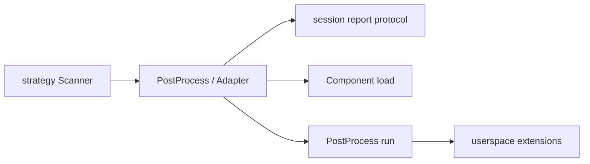

# Adapter 架构文档
**版本：** `0.3.2`

## 架构图

`modules.post_process` 负责：
1. 将扫描结果规范为三层出口协议（`Opportunity` / `StrategyScanReport` / `ScanSessionReport`）
2. 发现、校验、执行 userspace **PostProcess**（无序 Component 集合 + 可选 `depends_on`）
策略 Scanner 在 present 阶段通过 `PostProcessDispatcher` 调用本模块门面。

```text
Adapter (Facade)
  ├── build_session_report / validate_session
  ├── list/validate/load Component
  └── list/validate/load/run PostProcess
contracts
  ├── Opportunity / StrategyScanReport / ScanSessionReport
  └── BaseAdapter
core/
  ├── protocol / session_builder
  ├── adapter_loader / validator
  └── post_processor_loader / validator / executor / topo
```



## 职责与边界（结论）

**In scope：** 协议、Component / PostProcess 契约与发现执行、userspace 目录约定  
**Out of scope：** 扫描调度、可交易演示协议、具体通知/券商实现；策略 `PostProcessDispatcher` 属 `modules.strategy`

## 相关文档

- [用户指南](./USER_GUIDE.md)
- [PROTOCOL.md](./PROTOCOL.md)
- [POST_PROCESS.md](./POST_PROCESS.md)
- [API.md](../API.md)
- [术语表](../glossary.yaml)
- [决策](./DECISIONS.md)
