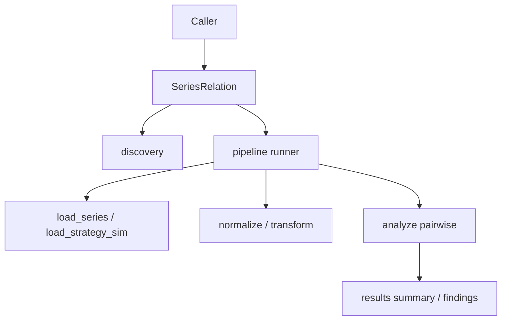

# SeriesRelation — 架构

**模块：** `modules.series_relation` · **版本：** `0.2.0`

**最低支持核心版本：** `>=0.5.0`

## 职责与边界（结论）

把 2 到 `MAX_SERIES` 条序列放在同一时间轴上，输出**描述性**的两两关系：

- 相关强度与方向（Pearson / Spearman）
- 滞后天数与滞后处的相关（`best_lag_days` / `best_lag_corr` / `lead`）
- 缩放关系（`beta` / `alpha` / `scale_r2`）
- 关系的滚动稳定性（`rolling`）

**不做：** 因果推断、因子有效性判断、买卖建议。相关不等于因果，滞后不等于领先。

## 模块结构图

```text
series_relation/
├── series_relation.py       # Facade
├── contracts.py             # DiscoveredRelation
├── core/
│   ├── constants.py
│   ├── settings/relation_settings.py
│   ├── discovery/
│   ├── persist/
│   └── pipeline/            # load / normalize / transform / analyze / runner
└── __test__/test_api.py
```

依赖方向：`series_relation.py` → `core/`；`core/pipeline/` → `core/settings` 与 engines；反向不成立。

## 架构图



## 数据流


## 依赖（结论）

| 依赖 | 用途 |
|------|------|
| `modules.data_manager` | `data_key` 声明与序列读取 |
| `modules.data_contract` | 声明查找 |
| `modules.strategy` | 回测产物的净值与价格累计 |
| `infra.project_context` / `infra.discovery` | 输出目录与发现 |

被依赖方：`cli`（`srel`）、BFF（`/v1/series-relations/*`）、UI（`seriesRelationPage`）。

`userspace/extensions/series_relation/<key>/results/` 下：

| 文件 | 内容 |
|------|------|
| `summary.json` | 设定、系列清单、两两指标与滚动稳定性 |
| `series.json` | 日历并集与各序列归一化点 |
| `findings.md` | 面向人的解释与配对结论 |
| `meta.json` | 跑批信息与指纹 |
| `report.txt` | CLI 人读短报告 |

- `best_lag_days` 在**归一化水平值**上扫描 ±20 天；滞后结论只能作参考。
- 序列有缺口时按并集对齐；重叠样本不足时 `reliable=False`。
- `relation` 的符号只描述统计方向，与基本面因果无关。

## 相关文档

- [用户指南](./USER_GUIDE.md)
- [公开 API](../API.md)
- [术语表](../glossary.yaml)
- [决策](./DECISIONS.md)