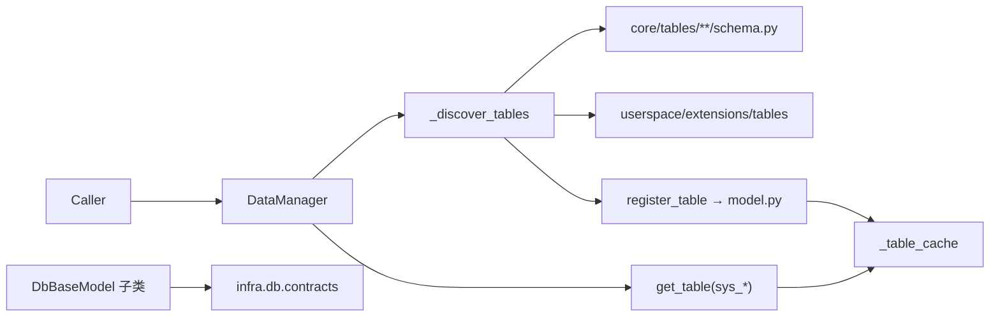

# Tables — 架构

**模块：** `tables` · **版本：** `0.4.3`

**最低支持核心版本：** `>=0.5.0`

内置表定义的静态仓库。`DataManager` 启动时与 `userspace/extensions/tables` 一并递归发现 `schema.py`，注册 `model.py` 中首个 `DbBaseModel` 子类。

---

## 职责与边界（结论）

**负责**

- 声明所有内置 `sys_*` 表的字段、索引、`storage_domain`、`update_key`
- 提供各表 `DbBaseModel` 子类及必要的领域读写方法（如 adj_factor CSV 导入）

**不负责**

- 连接管理、DDL 执行、写队列（`infra.db`）
- 表发现编排、用户表脚手架（`modules.data_manager`）
- 用户自定义 `cust_*` 表（`userspace/extensions/tables`）

---

## 模块结构图

```text
core/tables/
├── module_info.yaml
├── glossary.yaml
├── README.md
├── API.md
├── __test__/
├── docs/
│   ├── ARCHITECTURE.md
│   └── USER_GUIDE.md
├── stock/
│   └── <table>/
│       ├── schema.py
│       └── model.py
├── industry/
├── macro/
├── calendar/
├── index/
├── tag/
└── system/
```

---

## 架构图



---

## 数据流

```text
schema.py（声明）
  → DataManager 发现 / register_table
  → DbBaseModel 绑定默认 db
  → renew / 回测 / BFF 经 get_table 读写
```

---

## 依赖（结论）

- 无模块级 `dependencies`；各 `model.py` 使用 `infra.db.contracts.DbBaseModel`，部分表按需使用 `infra.utils`、`project_context`、`data_manager`（仅限该表领域逻辑）。

---

## 相关文档

- [README](../README.md)
- [API](../API.md)
- [术语表](../glossary.yaml)
- [用户指南](./USER_GUIDE.md)
- [DataManager 架构](../../modules/data_manager/docs/ARCHITECTURE.md)